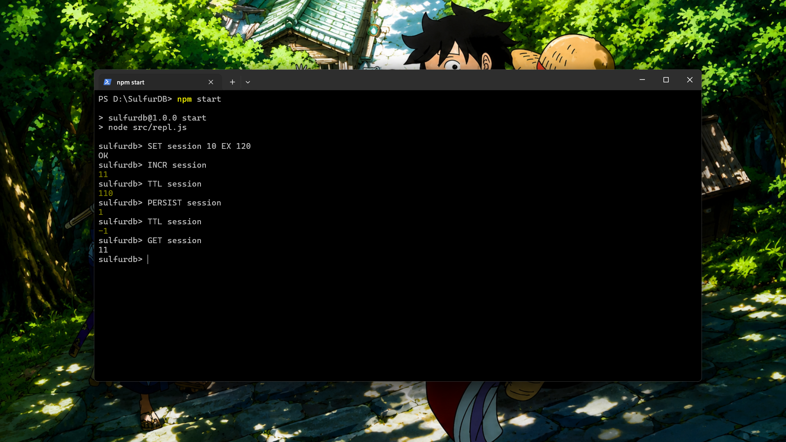
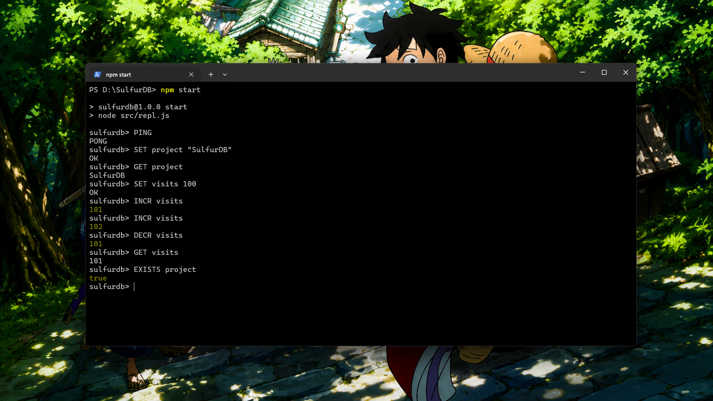
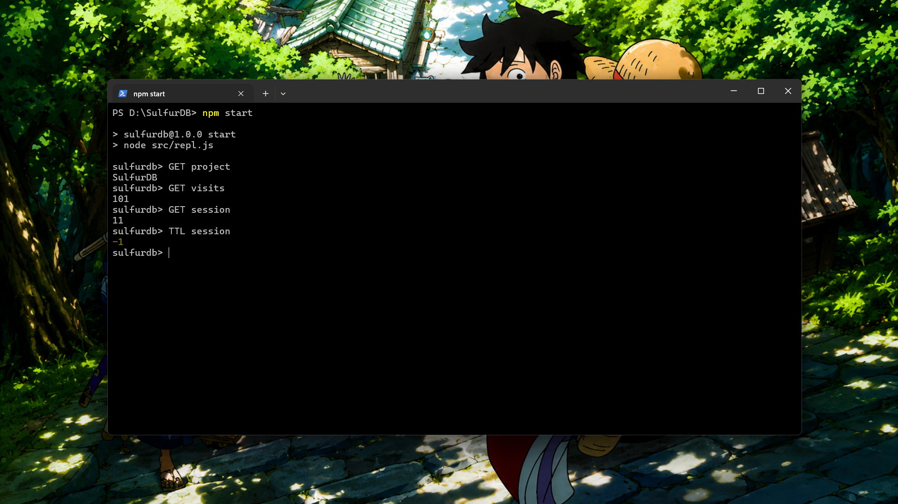
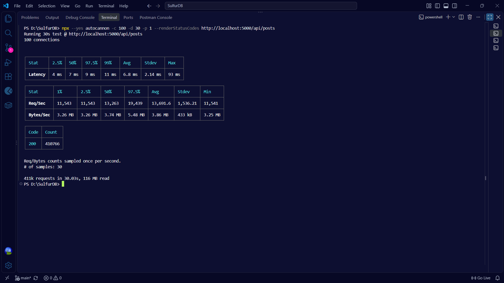
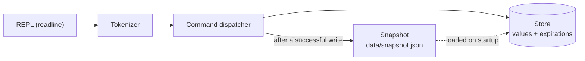

# SulfurDB

A Redis inspired in-memory key-value store built from scratch in JavaScript. Parses commands, stores data in memory, expires keys with TTLs, and saves snapshots to disk so your data survives a restart. All with a core that uses nothing but Node.js built-ins.


## Preview

<table>
  <tr>
    <td width="50%" align="center">
      <h3>Core Commands</h3>
      
    </td>
    <td width="50%" align="center">
      <h3>TTL and PERSIST</h3>
      
    </td>
  </tr>
  <tr>
    <td width="50%" align="center">
      <h3>Persistence</h3>
      
    </td>
    <td width="50%" align="center">
      <h3>Benchmark Results</h3>
      
    </td>
  </tr>
</table>

## Features

- **Key-value storage**: store, overwrite, read, check and delete keys, backed by a JavaScript `Map`
- **Key expiration**: `SET key value EX seconds` with lazy expiry, `TTL` to inspect the remaining lifetime and `PERSIST` to remove it
- **Atomic counters**: `INCR` and `DECR` with integer validation and overflow protection (safe-integer range)
- **Disk snapshots**: every successful write saves `data/snapshot.json`, and the snapshot is loaded back on startup. Expiry deadlines survive restarts, and keys that expired while the server was down are dropped on load
- **Command parser**: tokenizer with single/double quoted values (spaces and empty strings supported), case-insensitive command names, and argument-count validation
- **Interactive REPL**: a terminal interface built on `node:readline`
- **Monotonic expiry clock**: expiration uses `performance.now()`, so system clock changes can't expire or resurrect keys. Snapshots convert deadlines to wall-clock time only when saving or loading
- **Injectable clock**: pass your own `now()` into the store for deterministic expiry tests, with no `sleep` needed
- **Embeddable**: use the `Store` class directly as an in-process cache, as shown in the Express example

## Tech stack

| Layer | Tech |
|---|---|
| Runtime | Node.js 18+, ES modules |
| Language | JavaScript |
| Storage | In-memory `Map` (values) + `Map` (expiry deadlines) |
| Interface | `node:readline` REPL |
| Persistence | `node:fs` JSON snapshots |
| Integration example | Express 5 |
| Benchmarking | autocannon |

## How it works



1. The **REPL** reads a line and hands it to the dispatcher.
2. The **tokenizer** splits it into arguments, respecting quotes.
3. The **dispatcher** validates the command and argument count, then calls the `Store`.
4. The **store** reads or writes its maps. Expired keys are purged lazily whenever they are touched.
5. After any successful write (`SET`, `DEL`, `INCR`, `DECR`, `PERSIST`), the REPL **saves a snapshot** to disk.

## Supported commands

| Command | Syntax | Returns |
|---|---|---|
| `PING` | `PING` | `PONG` |
| `SET` | `SET key value` | `OK` |
| `SET` with TTL | `SET key value EX seconds` | `OK` |
| `GET` | `GET key` | The value, or `null` if the key is missing or expired |
| `EXISTS` | `EXISTS key` | `true` / `false` |
| `DEL` | `DEL key` | `Deleted` / `Key does not exist` |
| `TTL` | `TTL key` | Remaining seconds, `-1` or `-2` (see below) |
| `PERSIST` | `PERSIST key` | `1` if the expiry was removed, otherwise `0` |
| `INCR` | `INCR key` | The new integer value |
| `DECR` | `DECR key` | The new integer value |
| `EXIT` | `EXIT` | Closes the REPL |

Command names are case-insensitive. Keys and values keep their casing. Quote values that contain spaces:

```text
SET greeting "hello world"
SET empty ""
```

### TTL return values

| Value | Meaning |
|---:|---|
| `-2` | The key does not exist (or has expired) |
| `-1` | The key exists with no expiration |
| `0` or more | Remaining whole seconds, rounded down |

An expired key behaves exactly like a missing key for `GET`, `EXISTS`, `DEL`, `TTL`, `PERSIST` and `INCR`/`DECR`.

### Counters

- `INCR` / `DECR` on a missing key start from `0`
- Existing TTLs are **preserved** when a counter changes
- Non-integer values and results outside the safe-integer range return `ERR value is not an integer or out of range`

### Errors

| Response | When |
|---|---|
| `ERR wrong number of arguments` | Wrong argument count for the command |
| `ERR syntax: SET key value [EX seconds]` | Four-argument `SET` without the `EX` keyword |
| `ERR invalid expire time` | TTL is not a positive integer |
| `ERR unknown command: <NAME>` | Unrecognised command |
| `Key cannot be empty` | An empty-string key was given |

## Persistence

Snapshots are plain JSON, written to `data/snapshot.json` (git-ignored) and loaded when the REPL starts:

```json
{
  "version": 1,
  "entries": [
    { "key": "project", "value": "SulfurDB", "expiresAt": null },
    { "key": "session", "value": "abc123", "expiresAt": 1791939600000 }
  ]
}
```

- `expiresAt` is a wall-clock timestamp in milliseconds, or `null` for keys that never expire
- Entries that are already expired are skipped on both save and load
- A snapshot with an unknown `version` is rejected

## Project structure

```
.
│── images/            # README screenshots
├── src/
│   ├── store.js             # Store class: storage, TTL, INCR/DECR, snapshot create/load
│   ├── commands.js          # Tokenizer + command dispatcher
│   ├── persistence.js       # Snapshot save/load (data/snapshot.json)
│   └── repl.js              # Interactive terminal
├── tests/
│   ├── store_test.js        # Store smoke test
│   └── api_test.js          # Express cache-aside example (benchmark target)
├── package.json
└── LICENSE
```

## Getting started

### Prerequisites

- Node.js 18 or newer
- Git

### Setup

```bash
git clone https://github.com/sulfurcodes/SulfurDB-An-in-memory-database.git
cd SulfurDB-An-in-memory-database
npm install
npm start
```

`npm install` is only needed for the Express example, since the database core uses Node.js built-ins.

### Example session

```text
sulfurdb> SET username "sulfurcodes"
OK
sulfurdb> GET username
sulfurcodes
sulfurdb> SET session abc123 EX 60
OK
sulfurdb> TTL session
59
sulfurdb> PERSIST session
1
sulfurdb> TTL session
-1
sulfurdb> INCR visits
1
sulfurdb> DEL username
Deleted
sulfurdb> EXIT
```

## Using SulfurDB as a library

The `Store` class works on its own, with no REPL needed:

```js
import Store from "./src/store.js";

const db = new Store();

db.set("session", "abc123", 60); // expires in 60 seconds
db.get("session");               // "abc123"
db.ttl("session");               // 59
db.incr("visits");               // 1
```

### Deterministic expiry with an injected clock

```js
let time = 0;
const db = new Store({ now: () => time });

db.set("key", "value", 5);
db.get("key");   // "value"

time = 5000;     // jump 5 seconds forward, no waiting
db.get("key");   // null
```

### As an Express cache

`tests/api_test.js` shows a cache-aside route using a `Store` instance with a 10-second TTL and `X-Cache: HIT` / `MISS` headers:

```js
app.get("/api/posts", (req, res) => {
  const cached = store.get("posts");
  if (cached !== null) {
    return res.set("X-Cache", "HIT").json(cached);
  }
  const data = { message: "Hello from SulfurDB" };
  store.set("posts", data, 10);
  res.set("X-Cache", "MISS").json(data);
});
```

Run it with `node tests/api_test.js` (listens on port `5000`).

## Benchmarks

Load tested with **autocannon** against the Express cache-aside route above (`GET /api/posts`), with SulfurDB serving as the in-process cache.

```bash
node tests/api_test.js
npx autocannon -c 100 -d 30 -p 1 --renderStatusCodes http://localhost:5000/api/posts
```


### Results

| Connections | Duration | Avg RPS | Avg latency | p99 latency | Max latency | Total requests |
|---|---|---|---|---|---|---|
| 100 | 30s | 13,692 req/s | 6.8 ms | 11 ms | 93 ms | 410,766 (all `200`) |

> These numbers measure the whole path (Express, HTTP and the SulfurDB lookup together), not the store in isolation. They were run locally on a development machine and should not be read as production capacity.

## How it differs from Redis

SulfurDB is an educational project, not a drop-in Redis replacement.

| | Redis | SulfurDB |
|---|---|---|
| Access | TCP server, RESP protocol | In-process library + local REPL |
| Compatibility | Works with standard clients | Not compatible with Redis clients |
| `EXISTS` / `DEL` replies | Integers | `true`/`false` and `Deleted`/`Key does not exist` |
| Persistence | RDB + AOF | Full JSON snapshot after each write |
| Data types | Strings, lists, hashes, sets, ... | Strings (counters via `INCR`/`DECR`) |

## Current limitations

- No standalone TCP server or client, and no Redis wire protocol
- Snapshots rewrite the whole dataset after each write, and are not yet written atomically
- Expired keys are removed lazily, so a key that is never read again stays in memory until it is accessed
- The tokenizer treats `'` and `"` as the same quote character, and has no documented escape grammar or malformed-quote validation
- Only string values and a small command set (no lists, hashes, sets or `KEYS`)
- Tests are currently a smoke test and an integration example, not a full automated suite

## License

MIT